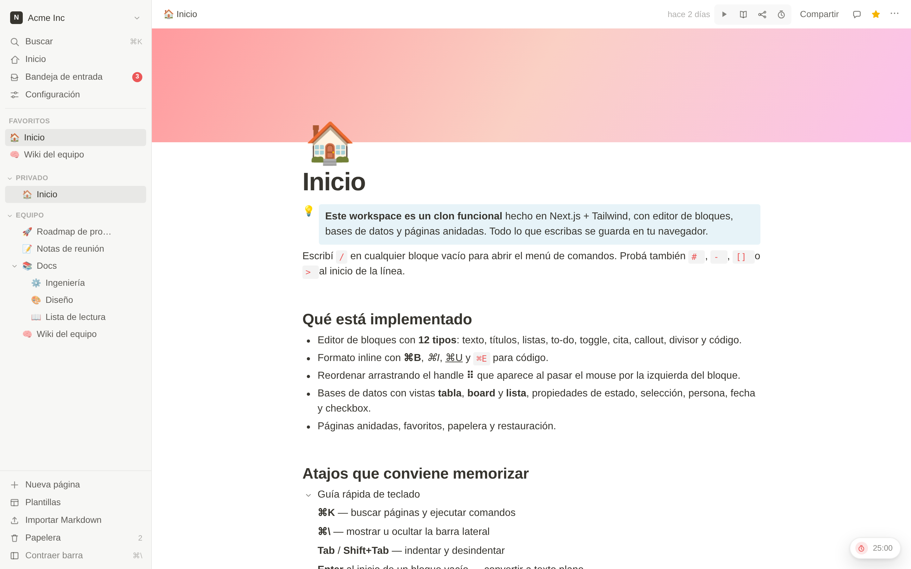
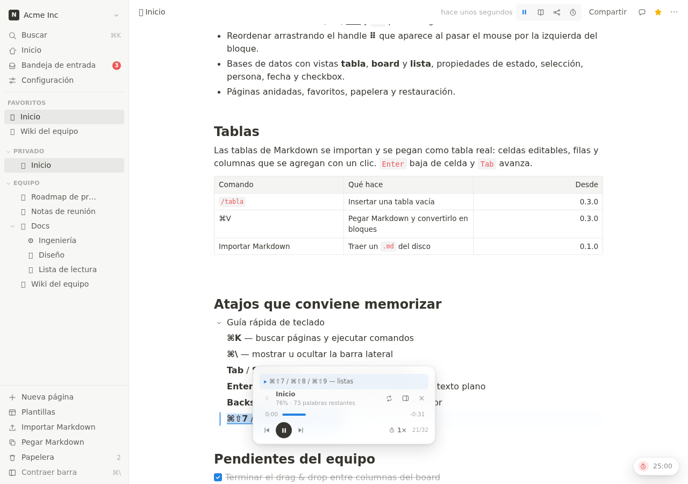
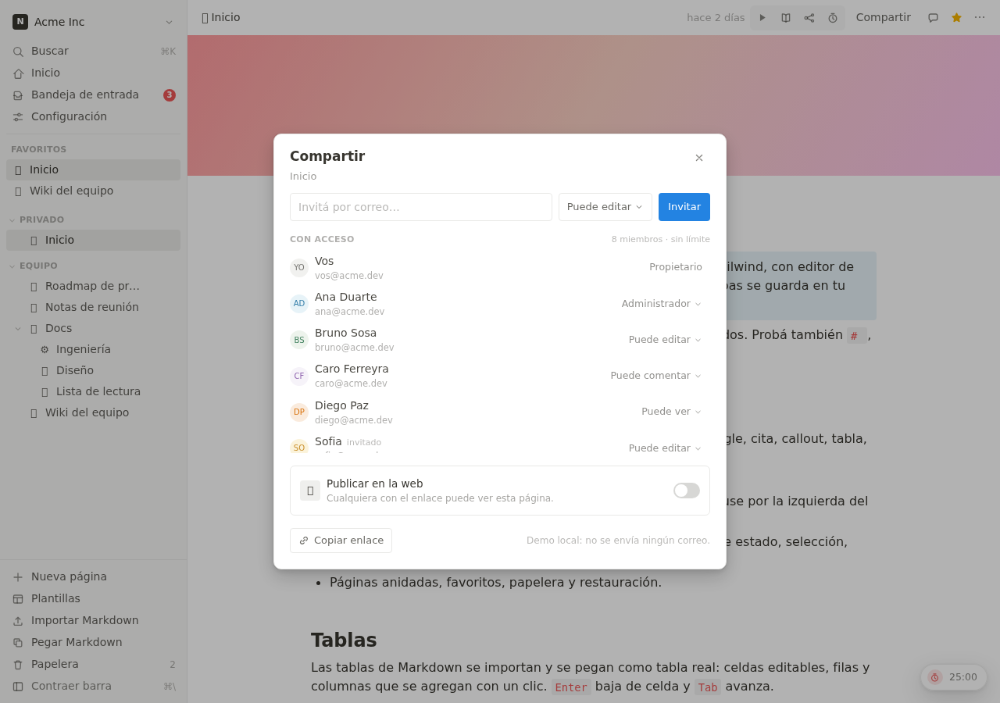
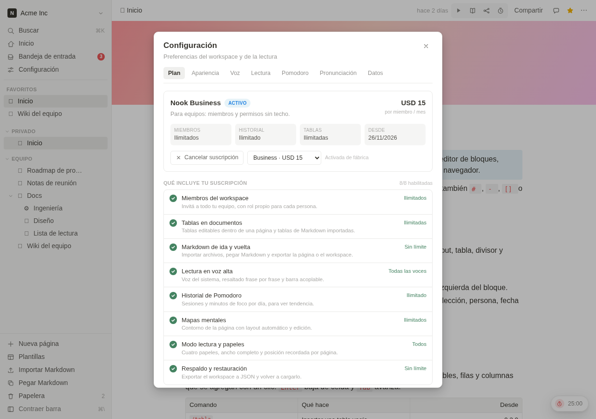

# Nook — workspace tipo Notion

[](https://github.com/OWNER/REPO/actions/workflows/ci.yml)
[](https://github.com/OWNER/REPO/actions/workflows/desktop.yml)
[](https://github.com/OWNER/REPO/releases/latest)
[](https://OWNER.github.io/REPO/)
[](./LICENSE)



| Tablas y resaltado de lectura | Miembros sin límite |
|---|---|
|  |  |



Clon funcional de la app de Notion (no de su web): **editor de bloques, bases de
datos con tres vistas, páginas anidadas, favoritos, papelera, ⌘K y modo oscuro**
— y, desde la versión 0.2, una capa completa de **lectura y foco**:
lectura en voz alta con resaltado, barra flotante acoplable, modo lectura con
papel, mapas mentales, Pomodoro compartido e importación/exportación de archivos.

Next.js 15 (App Router) + React 19 + TypeScript + Tailwind + Zustand.
**Cero dependencias de UI, cero assets externos, cero tipografías de terceros.**

**Nuevo en 0.10.0:** **carpetas** en el árbol —agrupan páginas y **archivos
adjuntos**— con subida por botón o arrastrando, visor para imágenes, PDF, audio,
vídeo y texto, renombrar, mover y eliminar. Los adjuntos guardan su contenido en
IndexedDB, así que un PDF grande no te deja sin espacio para las notas. **84
verificaciones** en ocho suites.

**0.6.0:** ronda de auditoría — escrituras agrupadas en disco
(el editor dejó de reescribir el workspace entero en cada tecla: 40 escrituras y
126 ms por 20 letras pasaron a **1** y 4 ms), **exportación completa** del
workspace en un HTML con índice, y siete fallos reales corregidos, entre ellos
uno de seguridad: el historial de versiones se sanea al cargar. **73
verificaciones** en siete suites.

**0.5.0:** **historial de versiones por página** con la retención de
cada plan de Notion — 7 días en Gratis, **30** en Pro, **90** en Business y sin
límite en Enterprise. Se guarda solo mientras escribís, restaurar es reversible
(antes de pisar el documento se guarda cómo estaba) y el historial vive en su
propia clave de almacenamiento, así que nunca puede dejarte sin espacio para
tus notas.

**0.4.3:** la lectura en voz alta **subraya por donde va** (también con
voces que no emiten eventos), se puede **empezar a leer desde cualquier párrafo**
con clic derecho, y **F11** pone la app en pantalla completa.

**0.4.2:** dos rondas de auditoría sobre 0.4.0 — el HTML del editor se
sanea por lista blanca (un pegado con formato o un respaldo ajeno ya no puede
inyectar código), el respaldo incluye los miembros, el mapa mental respeta la
sangría, las listas del HTML exportado son válidas y ningún overlay ignora
Escape. **46 verificaciones automatizadas** en cinco suites, todas en CI
([detalles](./CHANGELOG.md)).

**0.4.0:** la app se entrega con la **suscripción activa** — plan Business,
todas las capacidades habilitadas y **sin topes** — administrable en
*Configuración → Plan* y activable con una licencia offline
([detalles](./docs/SUSCRIPCION.md)).

**0.3.0:** tablas reales (también al importar o pegar Markdown), **pegado de
Markdown directo en el editor**, **miembros sin límite** y **resaltado frase por
frase** mientras se lee en voz alta.

> ### Descargar
>
> | | Dónde | Qué es |
> |---|---|---|
> | 🪟 **Windows** | [Releases → `Nook-*-portable.exe`](https://github.com/OWNER/REPO/releases/latest) | app de escritorio, 78 MB, no instala nada |
> | 🌐 **Cualquier sistema** | [Demo en GitHub Pages](https://OWNER.github.io/REPO/) | la misma app en el navegador, sin descargar |
> | 🧑‍💻 **Código** | `git clone` + `npm install` + `npm run dev` | ver [Arrancar](#arrancar) |
>
> Windows SmartScreen advierte la primera vez porque el `.exe` no está firmado con
> un certificado de código: *Más información → Ejecutar de todas formas*. Podés
> comprobarlo compilándolo vos mismo (`cd desktop && npm run build:win`).
>
> Análisis de la interfaz, evidencia y qué se replicó exactamente: **[ANALISIS.md](./ANALISIS.md)**
> Mapa de qué funciones de OpenHub se integraron y cuáles no: **[docs/OPENHUB.md](./docs/OPENHUB.md)**
> Cómo se empaqueta como app de escritorio (Electron): **[docs/EMPAQUETADO.md](./docs/EMPAQUETADO.md)**
> Subirlo a GitHub sin sorpresas: **[docs/GITHUB.md](./docs/GITHUB.md)**
> Capturas reales generadas con Chromium headless: **[docs/capturas](./docs/capturas)**

---

## Arrancar

```bash
npm install
npm run dev            # http://localhost:3000
npm run verificar      # antes de subir: tsc --noEmit + next build
npm run build:static   # genera out/ (sitio estático: base del .exe y del artifact)
```

Producción:

```bash
npm run build && npm start
```

Requisitos: Node 18.18+ (probado con Node 22). No necesita base de datos ni
variables de entorno: el estado se guarda en `localStorage`.

> ⚠️ No corras `npm run build` con `npm run dev` en marcha: los dos escriben en
> `.next/` y el dev server empieza a devolver 404 en los assets. Si pasa:
> `rm -rf .next && npm run dev`.

---

## Qué hace

### Editor de bloques
Texto · Título 1/2/3 · lista con viñetas · lista numerada · lista de tareas ·
desplegable (toggle) · cita · bloque destacado (callout) · divisor · código.

- **Menú `/`** en cualquier bloque vacío, con búsqueda y navegación por teclado.
- **Atajos markdown** al empezar la línea: `# `, `## `, `### `, `- `, `1. `,
  `[] `, `> `, ` ``` `, `---`.
- **Handle lateral** al pasar el mouse: `+` inserta un bloque, `⠿` arrastra para
  reordenar (con línea azul de inserción).
- **Enter** parte el bloque donde está el caret · **Backspace** al inicio une con
  el anterior · **Tab / Shift+Tab** indenta · **↑ ↓** navegan entre bloques.
- Inline: **⌘B** negrita, **⌘I** itálica, **⌘U** subrayado, **⌘E** código.
- Toggles que pliegan a sus hijos por indentación.

### Páginas
Portada (galería de 12 gradientes), icono emoji, título autoexpandible,
breadcrumb navegable, favoritos, duplicar, papelera con restaurar, "ancho
completo", páginas dentro de páginas sin límite de profundidad.

### Bases de datos
Propiedades tipadas: **título, texto, selección, estado, persona, fecha, número,
checkbox**. Tres vistas en caliente:

- **Tabla** — edición inline, crear fila, borrar fila, ordenar columnas.
- **Board** — agrupado por estado, arrastrar tarjetas entre columnas.
- **Lista** — compacta, con pills de propiedades.

Filtro por estado, orden por cualquier propiedad, buscador, y creación de
opciones nuevas de selección escribiendo en la celda. Click en una fila abre el
**panel de fila** (peek) con título y todas las propiedades editables.

### Lectura en voz alta (Web Speech API)
Motor propio sobre `speechSynthesis`, con las voces **que ya tenga el sistema**
—no incluye ni descarga voces—.

- **Botón ▶ de la barra superior o `⌘⇧R`**: lee el título y todos los bloques
  visibles. Si hay texto seleccionado, lee **la selección**.
- **Clic derecho sobre cualquier párrafo → “Empezar a leer desde aquí”**: arranca
  en la frase que está justo debajo del puntero, no al principio de la página
  (la segunda opción, “Leer este bloque”, empieza en el bloque entero).
- **Resaltado sincronizado en dos capas**: la frase que suena se pinta suave y
  lo que la voz **ya pronunció** se marca más fuerte, de modo que se ve el avance
  palabra por palabra. El párrafo activo se marca aparte y la vista se desplaza
  sola si hace falta. También resalta el título.
- **Barra flotante de cristal esmerilado** con progreso, tiempo transcurrido y
  restante, palabras que faltan, fragmento actual, velocidad rápida y control de
  fragmento (anterior / repetir / siguiente / detener).
- **Tres posiciones**: flotante y arrastrable, o acoplada al lateral izquierdo o
  derecho en vertical. En vertical, anterior/siguiente/detener se quedan en una
  fila horizontal. La posición se guarda y también se mueve con las flechas
  cuando el asa tiene el foco.
- **`Espacio`** pausa o reanuda sin robarle la tecla al editor ni a los botones.
- Los bloques de código y los divisores no se leen, y lo que cuelga de un toggle
  cerrado tampoco.

Detalles de implementación que evitan los problemas clásicos de la API: la cola
se trocea **por frases de menos de 180 caracteres** (Chrome deja de emitir
`onend` en utterances largas), cada arranque invalida los callbacks viejos con un
token de generación, y hay un perro guardián que avanza si `onend` nunca llega.
La velocidad real (caracteres/segundo) se **calibra** con lo ya pronunciado, así
el tiempo restante no es una constante. El avance del subrayado **no depende de
`onboundary`**: muchas voces del sistema (las SAPI de Windows dentro de Electron,
por ejemplo) no emiten ese evento, así que un estimador alimentado por la
velocidad medida mueve el resaltado y los eventos reales, cuando llegan, lo
corrigen.

### Modo lectura
`⌘⇧E` o el icono de libro. Oculta el chrome de edición (botones de portada,
icono, handles) y aplica un **papel**: blanco, sepia, gris o negro. El tamaño del
texto es ajustable y hay una **barra fina de progreso** en el borde superior.

La **posición de lectura se guarda por página**: volvés a una nota de hace tres
días y retoma exactamente donde estabas. El pie de página muestra palabras y
minutos de lectura del documento.

### Mapa mental
`⌘⇧M` convierte la página en un mapa interactivo, sin librerías (SVG propio).

- Jerarquía desde los encabezados y las listas de la página.
- **Zoom** con rueda o botones, **paneo** arrastrando, **colapsar ramas** con
  click en el nodo, **encuadrar** y **expandir/colapsar todo**.
- **Búsqueda** con contador de coincidencias y salto a la siguiente (`Enter`).
- **Editor de contornos** lateral (ocultable) para reordenar el mapa sin tocar la
  página, y **modo foco**.
- **Exportación**: Markdown, SVG, PNG 2× y copiar contorno.

### Pomodoro compartido
`⌘⇧P` o el icono de reloj. Vive por encima del árbol de componentes, así que
cerrar el panel no lo detiene.

- Duraciones configurables de enfoque, descanso y descanso largo, con ciclo de N
  sesiones.
- Anillo de progreso, pausar, reiniciar, saltar fase.
- **Alarmas sintetizadas con WebAudio**: tres notas ascendentes al terminar el
  enfoque, dos descendentes al terminar el descanso. Sin archivos de audio.
- Histograma de los últimos 7 días y contador de hoy, persistido.

### Archivos
- **Importar** `.md` / `.markdown` / `.txt` desde el botón del sidebar o
  arrastrándolos sobre la barra lateral: se convierten en **bloques reales**
  (títulos, listas, tareas, citas, código, divisores), no en un `<pre>`.
- **Exportar** cualquier página a **Markdown** o a **HTML autónomo** desde el menú
  `⋯`, y **respaldo JSON** completo desde Configuración.

### Configuración
`⌘,` — seis pestañas: **Apariencia** (tema, ancho, papel), **Voz** (voz del
sistema, velocidad, tono, volumen, seguir la lectura, probar), **Lectura**
(tamaño, progreso, recordar posición), **Pomodoro**, **Pronunciación** (reglas
que cambian sólo lo que se pronuncia, nunca el documento) y **Datos** (métricas,
exportar/importar respaldo, restablecer).

---

## Atajos

| Atajo | Acción |
|---|---|
| `⌘K` | Buscar páginas / ejecutar comandos |
| `⌘\` | Mostrar u ocultar la barra lateral |
| `⌘⇧L` | Modo oscuro / claro |
| `⌘⇧R` | Leer la página en voz alta |
| `Clic derecho` | Empezar a leer desde ese párrafo |
| `Espacio` | Pausar / reanudar la voz |
| `F11` | Pantalla completa |
| `⌘⇧E` | Modo lectura (papel) |
| `⌘⇧M` | Mapa mental |
| `⌘⇧P` | Pomodoro |
| `⌘,` | Configuración |
| `?` | Ayuda de atajos |
| `/` | Menú de bloques |
| `⌘B` `⌘I` `⌘U` `⌘E` | Negrita · itálica · subrayado · código |
| `⌘⇧7` `⌘⇧8` `⌘⇧9` | Lista numerada · viñetas · tareas |
| `Tab` / `⇧Tab` | Indentar / desindentar |
| `Esc` | Cerrar menú o diálogo |

En Windows/Linux usá `Ctrl` donde dice `⌘`.

---

## Estructura

```
mi-app/
├── app/
│   ├── layout.tsx            metadata, fuentes del sistema, <html>
│   ├── page.tsx              monta <AppShell/>
│   └── globals.css           tokens (light/dark), papeles de lectura, cristal
├── components/
│   ├── AppShell.tsx          layout, tema, atajos globales, posición de lectura
│   ├── Sidebar.tsx           árbol, utilidades, importar Markdown (picker + drop)
│   ├── TopBar.tsx            breadcrumb + lectura/mapa/pomodoro + menú ⋯
│   ├── PageView.tsx          portada, icono, título, editor o base de datos
│   ├── Editor.tsx            bloques, caret, menú "/", drag & drop, markdown
│   ├── Database.tsx          tabla, board, lista, celdas tipadas, panel de fila
│   ├── CommandPalette.tsx    ⌘K (páginas + comandos, incluidos los nuevos)
│   ├── Settings.tsx          configuración en 6 pestañas
│   ├── Modals.tsx            compartir, atajos, papelera (+ `Shell` exportado)
│   ├── mindmap/MindMap.tsx   mapa mental: SVG, zoom, búsqueda, exportar
│   ├── pomodoro/Pomodoro.tsx provider + capa flotante + alarmas WebAudio
│   ├── tts/Speech.tsx        motor de voz (cola, token, perro guardián, calibración)
│   ├── tts/ReadingBar.tsx    barra flotante / acoplada
│   ├── tts/useReadAloud.ts   "leer página" o "leer selección"
│   ├── Icon.tsx              60 iconos SVG inline
│   └── ui.tsx                Popover, MenuItem, Pill, Avatar, Skeleton
├── lib/
│   ├── types.ts              modelo de datos + preferencias (voz, lectura, pomodoro)
│   ├── store.ts              Zustand + persist + todas las acciones + respaldos
│   ├── seed.ts               workspace de ejemplo (8 páginas, 2 bases de datos)
│   ├── speech.ts             texto→voz, troceado, reglas, métricas (puro)
│   ├── markdown.ts           Markdown ⇄ bloques, contornos, exportar HTML/MD
│   ├── mindmap.ts            árbol + layout tidy (puro)
│   └── utils.ts              árbol de páginas, fechas, paleta, descargas
├── desktop/                  app de escritorio: main.cjs (Electron) + config de electron-builder
├── .github/workflows/        ci.yml (build web) · desktop.yml (.exe)
├── scripts/
│   ├── capturas.mjs          17 capturas + verificación de runtime
│   └── export-static.mjs     build:static con la variable de entorno
└── docs/
    ├── capturas/             PNGs generados por ese script
    ├── OPENHUB.md            qué se integró del spec y qué no, con motivos
    └── EMPAQUETADO.md        cómo se arma el .exe con Electron y qué está verificado
```

---

## Integración continua

Dos workflows, con propósitos distintos:

**`ci.yml`** — en cada push a `main` y en cada pull request: `npm ci` →
`tsc --noEmit` → `next build` → `npm run build:static`. Deja un artifact
**`nook-web`** con el sitio estático comprimido, listo para servir o desplegar en
cualquier hosting estático. Se sube un `.zip` de `out/` y no la carpeta `.next`
porque `upload-artifact` **ignora archivos ocultos desde la v4.4** y `.next`
empieza con punto: eso producía el warning `No files were found with the provided
path: .next`.

**`desktop.yml`** — se dispara solo al cambiar `desktop/**`, la UI o el build
estático (también manual: *Actions → desktop → Run workflow*). Corre en
`windows-latest`, ejecuta `electron-builder` y deja el **`.exe` portable y el
instalador** en el artifact `nook-windows`. Tarda ~6-8 min. Ver
[docs/EMPAQUETADO.md](./docs/EMPAQUETADO.md).

Ninguno necesita secretos ni variables de entorno.

---

## Verificación automática

Hay **84 verificaciones** en ocho suites, cada una contra el sitio estático ya
compilado (se sirve `out/` en el puerto 4321). Salen con código 1 si algo falla,
así que sirven tanto a mano como en CI:

```bash
npm run build:static
python3 -m http.server 4321 --directory out &

node scripts/verificar-030.mjs      http://127.0.0.1:4321   #  15 — editor, tablas, pegado, export, mapa, arrastre, teclado
node scripts/verificar-040.mjs      http://127.0.0.1:4321   #  12 — suscripción, licencias, topes, respaldo y export completo
node scripts/verificar-seguridad.mjs http://127.0.0.1:4321  #  13 — saneo de HTML, datos corruptos y entradas basura
node scripts/verificar-movil.mjs    http://127.0.0.1:4321   #   3 — ventanas angostas y scroll horizontal
node scripts/verificar-modales.mjs  http://127.0.0.1:4321   #  11 — cada modal y el Pomodoro abren y cierran
node scripts/verificar-lectura.mjs  http://127.0.0.1:4321   #   7 — seguimiento del subrayado, leer desde aquí, F11
node scripts/verificar-historial.mjs http://127.0.0.1:4321  #  12 — versiones por página, retención, cuota llena, respaldo
node scripts/verificar-carpetas.mjs http://127.0.0.1:4321  #  11 — carpetas, adjuntos, visor, topes, papelera, respaldo
```

Requiere `npx playwright install chromium`. El escritorio tiene su propia
comprobación, que arranca el binario empaquetado y lo mira por CDP:

```bash
cd desktop && npx electron-builder --linux dir && cd ..
xvfb-run -a node scripts/verificar-desktop.mjs desktop/release/linux-unpacked/nook-desktop
```

Todas corren en cada push (job `e2e` de `.github/workflows/ci.yml`).

### Capturas

```bash
npm run capturas
```

Recorre la app en Chromium headless, guarda **17 capturas** en `docs/capturas/` y
**sale con código 1 si hubo cualquier error de consola o de página**. Última
corrida: `✔ sin errores de consola ni de página`.

Como el contenedor de CI no tiene voces instaladas, el script inyecta un
`speechSynthesis` de prueba que emite `onstart`/`onboundary`/`onend` con
temporizadores. No reproduce audio: sirve para ejercitar la máquina de estados
del motor (cola, progreso, resaltado, avance entre fragmentos) y poder capturar
la barra. En una máquina con voces reales el motor usa las del sistema.

---

## Publicarlo en GitHub y compartirlo

Guía paso a paso (repo, demo, release y checklist previo a invitar gente):
**[docs/GITHUB.md](./docs/GITHUB.md)**.

El resumen:

1. **Crear el repo vacío** en GitHub (público, sin README ni .gitignore).
2. **Push** del proyecto — con GitHub Desktop (*File → Add Local Repository… →
   Publish repository*) o con `git remote add origin … && git push -u origin main`.
3. **Settings → Pages → Source: GitHub Actions** para publicar la demo. Queda en
   `https://OWNER.github.io/REPO/`. Es un paso manual y de una sola vez: el token
   del workflow no tiene permiso para crear el sitio de Pages, así que si falta,
   el workflow **pages** avisa en el resumen y se saltea la publicación en vez de
   fallar.
4. **Taggear** para publicar la versión descargable:

   ```bash
   git tag v0.6.0 && git push origin v0.6.0
   ```

   El workflow **release** compila el `.exe` y lo adjunta a
   `https://github.com/OWNER/REPO/releases/latest`. **Ese es el enlace que se
   comparte**: cualquiera lo baja sin cuenta y sin pasar por Actions.

5. Reemplazá los `OWNER/REPO` de este README, `CHANGELOG.md` y las plantillas de
   `.github/ISSUE_TEMPLATE/` por tu usuario y tu repo.

> Si arrancás desde el `.zip`: descomprimí, abrí la carpeta en GitHub Desktop y
> seguí los pasos. El zip **no** incluye `node_modules`, `out/`, `desktop/release/`
> ni `.git`: `npm install` y `npm run build:static` los regeneran.

---

## Comunidad

- **Bugs y propuestas:** usá las plantillas de issues del repo.
- **Cómo contribuir:** [CONTRIBUTING.md](./CONTRIBUTING.md) (mapa del código,
  contrato del store, recetas y reglas del proyecto).
- **Convivencia:** [CODE_OF_CONDUCT.md](./CODE_OF_CONDUCT.md).
- **Seguridad:** [SECURITY.md](./SECURITY.md) — reportes privados, no en issues.
- **Historial de versiones:** [CHANGELOG.md](./CHANGELOG.md).
- **Modelo de suscripción y licencias:** [docs/SUSCRIPCION.md](./docs/SUSCRIPCION.md).
- **Publicar tu propio fork o release:** [docs/GITHUB.md](./docs/GITHUB.md).

Licencia [MIT](./LICENSE): podés usarlo, modificarlo y redistribuirlo citando el
copyright.

## Privacidad

Todo vive en el `localStorage` de tu navegador. **No es almacenamiento
cifrado**: quien tenga acceso al perfil del sistema puede inspeccionarlo. No hay
cuenta, backend, analítica ni envío de documentos a terceros.

---

## Pendientes (roadmap)

Ordenados por impacto, no por dificultad:

1. **Deshacer/rehacer global** (⌘Z) con historial de snapshots del store.
2. **Selección múltiple de bloques** (Shift+click / arrastre) y acciones en lote.
3. **Drag & drop de páginas** en el sidebar (mover ya funciona por código).
4. **Cuerpo de la fila**: que cada fila de la base de datos sea una página con
   bloques propios (hoy el peek muestra sólo propiedades).
5. **Bloques de imagen, video y archivo** con upload a `IndexedDB`.
6. **PDF y Office en el visor** (`pdfjs-dist` + `mammoth`/SheetJS): requiere
   guardar binarios fuera de `localStorage`, por eso quedó fuera de esta fase —
   ver el razonamiento en [docs/OPENHUB.md](./docs/OPENHUB.md).
7. **Búsqueda con ranking** (hoy es `includes`) y resultados por contenido.
8. **Backend**: el camino corto es Supabase (Postgres + Realtime) reemplazando
   `lib/store.ts`; el modelo ya está serializado en JSON, así que migra sin
   fricción.

---

## Nota legal

Proyecto educativo de replicación de **patrones de interfaz**. No incluye
código, assets, logos, nombres de marca ni tipografías de Notion, ni código de
OpenHub, y no está afiliado a Notion Labs ni a SrMaxi. Todos los nombres de
producto del seed son ficticios. Si lo publicás, evitá presentarlo como el
producto original o usar su marca: eso sí trae problemas.
